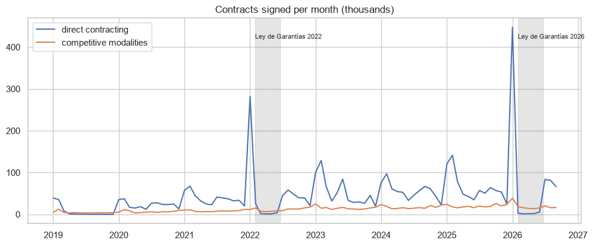
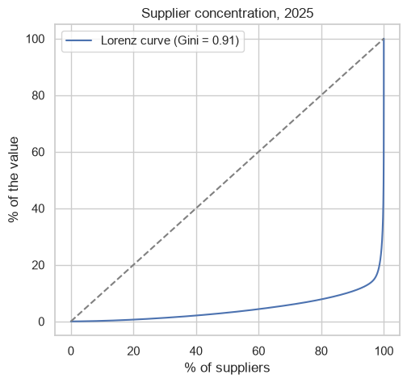

# Public procurement in Colombia (SECOP II)

How does the Colombian State buy? I analyse around 5 million contracts of SECOP II: modalities, departments, supplier concentration, and the effect of the Ley de Garantías (no direct contracting in the months before the presidential elections).

## Data
SECOP II - Contratos Electrónicos (datos.gov.co, `jbjy-vk9h`), 2019 to September 2026. All the aggregations are done in the API with SoQL (like SQL).

## Main results
- Around 1 million contracts per year. 80% are direct contracting, but only 40-53% of the value.
- Ley de Garantías: in January 2026 the State signed 447.596 direct contracts, and from February to June only around 2.600 per month (in a normal year 40.000 to 70.000).
- Bogotá has 41% of the value, Antioquia 14%.
- The top 1% of the 572.835 suppliers of 2025 received 77% of the value (Gini 0.91). SMEs only around 20%.




## How to run

```
pip install -r requirements.txt
jupyter notebook secop_procurement.ipynb
```

---
Alejandro Lezcano Osorio | Universidad EIA (Colombia) and Rennes School of Business (France)
